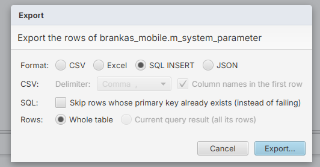

# To do

## Open

7. [ ] **Background tasks panel**: a small panel you can hide that lists everything running in the background (queries, compares, scans, exports / imports), with a way to stop each one.
8. [ ] **Export SQL INSERT: choose the key columns.** Today "Skip rows whose primary key already exists" works only on the primary key. Let the user pick which columns decide that a row already exists, so tables without a primary key (or with a surrogate id) can be exported too.
   
9. [ ] **Settings: on exit.** One option to choose between asking before closing and closing at once (even with queries running), and one to reopen the tabs that were open last time. Both can be switched on and off in Settings.
   - ? What should "force close" do with unsaved scripts and running queries?
10. [ ] **Scan: save and reopen** a scan's settings and its report as a .dbscan file (phase 5 of #1, see docs/scan-plan.md).
12. [ ] **Data Compare: leave out the primary key.** An option to compare without the primary key column(s), for tables whose ids differ between the two databases while the data is the same.
15. [ ] **Ctrl+F in every text view.** It already works in the SQL editor, the data grid, Data Compare and Scan. Still missing: the value panel, the diff view, the match rows view, and the read-only SQL previews (Generate SQL, Replace, Compare queries).
16. [ ] **Wrap a selection in brackets**: select text and type `(`, `[`, `{` (or a quote) to put the text inside them instead of replacing it.
17. [ ] **Ctrl+Shift+T reopens the last closed tab**, with its content. Closed tabs are kept for 10 minutes.
18. [ ] **Highlight the row of the selected cell** in the data grid, so the whole row is easy to follow.
19. [ ] **Data grid: copy rows as SQL.** Right-click selected rows → Copy as INSERT / UPDATE / DELETE, without running anything. (Adding, editing, duplicating and deleting rows is done, see #3.)
20. [ ] **Data grid: preview the row a foreign key points to.** In the value panel, a cell in a foreign key column shows the referenced row from the related table.
21. [ ] **Data Compare: record mode.** Show one compared row as a list of columns (source and target side by side), for tables with many columns. Boolean columns show as check boxes.
22. [ ] **Data Compare: hide columns with no changes.** Columns where no row has a difference are collapsed by default, with a toggle to show them.
23. [ ] **Sequences.** ? Not clear yet: a Sequences node in the navigator (name, current value, increment), and / or sequences in the table's Properties?

## Done

1. [x] **Scan Data** (v0.2.0): Tools → Scan Data… finds values in every table and column (findings, coverage, matching rows), and Replace… writes the script that replaces them (see docs/scan-plan.md). Save and reopen is #10.
2. [x] **One data view everywhere**: the table tab and the script results both use DataView (grid, value panel, editing).
3. [x] **Add, duplicate, edit and delete rows** in the data view. Right-click a row: Add Row, Duplicate Row(s), Delete Row(s) / Keep Row(s), and Set DEFAULT on a new row's cell. New rows are green with [DEFAULT] cells (left to the database: serial ids, defaults), deleted rows red and struck out. Nothing is written until Save, which shows every DELETE / UPDATE / INSERT and runs them in one transaction. The table tab reloads after saving; in script results the new rows stay but can be edited only after running the query again. No keyboard shortcut for delete.
4. [x] **Warning level per connection**: "Warn before" in the connection form (0 nothing, 1 drop / truncate / update or delete without WHERE, 2 any change, 3 inserts too; old connections get 1). Scripts and the table query box ask before running, naming the connection; Cancel is the default. Saving table edits and importing already ask every time, with the SQL.
5. [x] **Table actions**: in the navigator's right-click menu on a table and the table tab's Table menu. Backup Table… (a copy with all rows, named <table>_backup_<date>) and Rename Table… on any writable connection, as its warning level says. Truncate Table… (rows deleted, ids keep counting), Reset Table… (rows deleted, ids from 1) and Drop Table… only when the connection's warning level is 0; each always asks, showing the SQL, Cancel the default. Never on views or read-only connections.
6. [x] **Edit the table structure**: Properties → Columns / Constraints / Foreign Keys / Indexes have Add…, Edit…, Drop (buttons, right-click, double-click to edit). Each form shows the SQL it makes as you type; Apply runs it as the connection's warning level says, Drop always asks. PostgreSQL and SQLite run a change in one transaction; MySQL makes each statement at once and says which ones were made if a later one fails. Constraints, indexes and foreign keys are edited by drop + create. SQLite can only add, rename and drop columns and create / drop indexes; the form says so for the rest.
13. [x] **Open .dbcompare files by drag and drop**: drop one or more on the window and each opens in its own Table or Data Compare tab, like .sql files (and with the same license check as Open Compare Report…).
14. [x] **Table tab: the connection name stands out**: it now sits on its own line above the table name, in bold with its database icon and read-only / read-write (read-write in orange, like the script toolbar).
11. [x] **Script tab title shows its connection**: `*Untitled-4 · 03 Antam PreProd` (nothing after the name while no connection is picked); it follows a change of connection and a rename, and the tooltip names the connection too.
